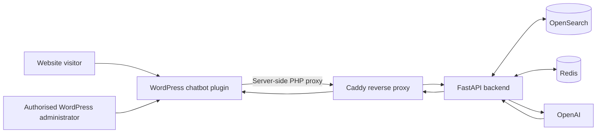
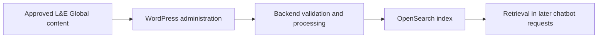

# L&E Global Employment Law Assistant

> Technical overview and entry point for developers, maintainers, and deployment operators.
>
> **Documentation status:** This README is based on the *L&E Global Employment Law Assistant — TECH guide* (Quadratic). Environment-dependent settings and repository-specific development commands must be checked against the current code and deployed release before publication.

## Overview

The **L&E Global Employment Law Assistant** is a WordPress-integrated chatbot that helps visitors explore general employment-law information covered by L&E Global's approved country documents. Visitors can ask questions in English, request country comparisons on a clear legal topic, and find the relevant L&E Global country contact where applicable.

The assistant uses **retrieval-augmented generation (RAG)**: the backend searches the maintained legal corpus and supplies selected approved evidence to OpenAI for answer generation. The language model is **not** treated as an independent source of legal truth.

**Important:** The assistant provides general employment-law information, not personalised legal advice. It does not use public internet search to generate legal answers, and it must not fill gaps in approved sources with general model knowledge.

## Features and boundaries

- Answers to English employment-law questions for supported countries and topics.
- Comparisons of a specific employment-law topic across up to **6 supported countries**.
- Context-aware clarification and controlled responses when a country, topic or question is unclear or unsupported.
- Country-contact responses where relevant contact information is maintained.
- Progressive response streaming to the WordPress chatbot interface.
- WordPress administration of country documents, legal sections and contacts.
- Search restricted to the approved L&E Global legal corpus.

**Validated scope recorded in the Technical Guide:** 33 countries, 11 employment-law topics, a public question length of **2–2,000 characters**, and a configured maximum of **6 sources**. These values describe the documented release and should be rechecked after subsequent code or content changes.

The system does **not** provide visitor accounts, permanent visitor conversation storage, personalised legal advice or additional chat channels outside WordPress.

## Architecture

The current **validated client development integration** uses WordPress hosted separately from the backend Docker network. WordPress forwards requests server-side to the OVH host through **Caddy**, which proxies to FastAPI.



**Security boundary:** Browsers communicate with WordPress, not directly with FastAPI, OpenSearch, Redis or protected administration APIs. Backend credentials remain in server-side configuration.

The former Docker-internal WordPress URL (`http://backend:8000`) is **not** the validated endpoint for the current external WordPress development integration. The actual WordPress-to-backend URL must be read from its protected environment configuration.

### Responsibilities

| Component | Responsibility |
| --- | --- |
| WordPress plugin | Chatbot UI, shortcode, administration screens, request validation and server-side proxy |
| Caddy | Reverse proxy between externally hosted WordPress and the backend on the OVH host |
| FastAPI | Request validation, country/topic interpretation, application controls, retrieval and response orchestration |
| OpenSearch | Searchable representation of approved L&E Global legal documents |
| Redis | Temporary runtime support, including controls such as rate limiting where configured |
| OpenAI | Generation of English answers from the user request and selected approved evidence |
| Persistent host storage | Approved source DOCX files and, where relevant, processed document data |

## Request lifecycle

1. A visitor sends a question through the WordPress chatbot.
2. The WordPress plugin validates the request and forwards it server-side, with the required backend credentials.
3. FastAPI validates the input and determines the country or countries, legal topic and comparison intent.
4. FastAPI applies applicable runtime controls; Redis may be used for transient state.
5. For supported legal questions, FastAPI retrieves relevant approved records from OpenSearch.
6. The backend selects the evidence used as model context; optional reranking may reorder retrieved candidates.
7. When generation is appropriate, OpenAI produces an English response from the provided context.
8. FastAPI applies response rules and returns the result via Caddy and WordPress to the browser.

Some requests follow a shorter controlled path (clarification, unsupported country, out-of-scope query or country contact) rather than a full legal-answer RAG operation.

## Technology and infrastructure

The Technical Guide records the following **validated backend environment**, which is a point-in-time deployment snapshot rather than a universal installation requirement:

| Item | Documented value |
| --- | --- |
| Hosting | Single OVH host |
| Operating system | Ubuntu 26.04 LTS |
| Resources | 4 vCPU, 15 GiB RAM, 100 GB disk |
| Runtime/orchestration | Python/FastAPI, Docker Compose, systemd |
| Reverse proxy | Caddy |
| Search | OpenSearch 3.7 |
| Search administration | OpenSearch Dashboards |
| Cache/runtime support | `redis:7-alpine` |
| External model provider | OpenAI |
| Integration | WordPress plugin (PHP/JavaScript/CSS) |

The guide documents Docker 29.6.2, Docker Compose v5.3.1, and a pre-built backend image tag `le-global-backend:release-fdc461f` for its validated deployment. **Do not assume these versions or image tags are still the current release without checking the repository and server.**

## Repository and configuration

The Technical Guide confirms these repository resources:

```text
<repository-root>/
├── .env.example          # Documented environment variables; no real secrets
└── infra/
    └── compose.yml       # Backend Docker Compose services
```

Other directories, Python entry points, dependency files, plugin source paths and test commands must be taken from the **actual repository tree**, not inferred from the deployment guide.

The validated OVH checkout is:

```text
/opt/le-global-chatbot
```

The backend environment file is stored **outside the Git repository**:

```text
/etc/le-global-chatbot/le-global-chatbot.env
```

Configuration groups include application settings, OpenSearch, Redis, OpenAI, retrieval/reranking, public and administration API authentication, CORS, rate limits, and WordPress server-side integration credentials.

Examples of environment variable **names only** (never commit actual values):

```dotenv
OPENAI_API_KEY=<openai_api_key>
API_ACCESS_KEY=<backend_api_key>
ADMIN_API_KEY=<backend_admin_api_key>
```

On the WordPress server, the guide also documents protected configuration entries such as `LE_GLOBAL_CHATBOT_API_KEY` and `LE_GLOBAL_CHATBOT_ADMIN_API_KEY`.

## Working with the existing deployment

> These commands apply to the documented OVH environment and are not a fresh-install tutorial. Run them only with authorised server access and verify the target environment first.

### Check the deployed revision and service status

```bash
cd /opt/le-global-chatbot
git rev-parse --short HEAD

systemctl status le-global-chatbot.service --no-pager

docker compose \
  --env-file /etc/le-global-chatbot/le-global-chatbot.env \
  -f /opt/le-global-chatbot/infra/compose.yml \
  ps
```

The backend stack defined in `infra/compose.yml` contains FastAPI, OpenSearch, OpenSearch Dashboards and Redis. **WordPress is managed separately** in the validated architecture.

### Check application health

From the OVH host:

```bash
curl -sS http://127.0.0.1:8000/health
```

A healthy response is equivalent to:

```json
{
  "status": "ok",
  "service": "le-global-backend",
  "dependencies": {
    "opensearch": "ok",
    "redis": "ok"
  }
}
```

Additionally validate the **configured** Caddy-to-FastAPI path from the appropriate server or operator network. The specific externally reachable address may change between environments.

### Inspect logs before restarting

```bash
journalctl -u le-global-chatbot.service -n 200 --no-pager

docker compose \
  --env-file /etc/le-global-chatbot/le-global-chatbot.env \
  -f /opt/le-global-chatbot/infra/compose.yml \
  logs --tail=200 backend
```

Replace `backend` with `opensearch` or `redis` when inspecting the corresponding service.

### Restart the backend only if necessary

Capture the relevant diagnostic information **before** restarting. If the incident is limited to FastAPI:

```bash
docker compose \
  --env-file /etc/le-global-chatbot/le-global-chatbot.env \
  -f /opt/le-global-chatbot/infra/compose.yml \
  restart backend
```

A full supervised stack restart, when specifically required, uses:

```bash
sudo systemctl restart le-global-chatbot.service
```

After either operation, repeat the health checks and functional chatbot tests. The systemd unit does **not** restart externally managed WordPress.

## WordPress integration

The plugin is installed and managed on the WordPress side. It provides the public UI, administration interfaces and a server-side PHP proxy for calls to FastAPI.

Embed the standard assistant on a page:

```text
[le_global_chatbot]
```

Or use the floating launcher:

```text
[le_global_chatbot mode="floating"]
```

The shortcode can be placed on a page or in a shared template, depending on the WordPress site configuration. The chatbot is **not** automatically injected into every page.

If the chatbot is absent, verify plugin activation, shortcode placement, browser assets and caches. If requests fail, verify protected WordPress credentials, server-side connectivity to Caddy, backend health, PHP outbound-network restrictions and logs. Administration failures additionally require checking permissions, request nonces, administration credentials and backend administration APIs.

## API entry points

The Technical Guide identifies these backend endpoints:

| Path | Purpose |
| --- | --- |
| `/health` | Application and dependency health |
| `/api/v1/chat` | Standard chatbot request |
| `/api/v1/chat/stream` | Streaming chatbot request |
| `/docs` | FastAPI Swagger documentation when enabled and accessible |

**Do not copy request/response payloads or authentication header names from assumptions.** Refer to the OpenAPI specification served by the running backend and the matching repository release for exact schemas.

## Approved document corpus

The source of truth is the **approved L&E Global country documentation** and maintained country-contact information. OpenSearch holds a searchable representation, not an independent legal reference.

### Persistent paths

| Purpose | OVH host path | Backend container path |
| --- | --- | --- |
| Approved source DOCX documents | `/var/lib/le-global-chatbot/documents/source` | `/data/documents/source` |
| Processed/intermediate document data | `/var/lib/le-global-chatbot/documents/processed` | `/data/documents/processed` |

These are configured as persistent bind mounts for the document workflow. The processed directory may be empty depending on the active workflow.

The Technical Guide records **33 source DOCX files** and **1,582 OpenSearch records** in index `legal-documents-v1` for the validated snapshot. These counts must be verified after content changes.

### Content changes

Authorised administrators can replace a country document, update individual legal sections and maintain contacts. The controlled content lifecycle is:



After an update, verify both that the administration operation completed and that a focused chatbot question returns the updated approved information. For contacts, verify the maintained contact record and a relevant contact request. Test country comparisons if the updated material can be used in them.

## Technical validation

A release is not validated simply because its containers are running. Verification should cover the deployed Git revision, systemd/Compose status, `/health`, OpenSearch and Redis, WordPress-to-Caddy connectivity, administration pages where affected, and functional chatbot behaviour.

Recommended canary questions from the Technical Guide:

| Scenario | Sample question |
| --- | --- |
| Single country | `What are the main rules for termination of employment contracts in France?` |
| Comparison | `Compare termination of employment contracts in France and Germany.` |
| Contact | `I need legal advice for a complex termination case in Italy. Who should I contact?` |
| Unsupported country | `What are the employment law rules in Tunisia?` |

Expected behaviour includes grounding in approved documents, appropriate clarification or refusal outside the supported scope, correct contact handling, and successful rendering of streaming responses in WordPress.

## Security and privacy

- Keep OpenAI, backend, administration, OpenSearch, Redis and WordPress integration credentials **server-side**.
- Never commit `.env` files with secrets or expose keys in JavaScript, logs, screenshots or documentation.
- Protect administration features with WordPress access controls and backend administration credentials.
- Keep FastAPI (`8000`), OpenSearch (`9200`), Redis (`6379`) and OpenSearch Dashboards (`5601`) off the public internet.
- **Development-only warning:** The Technical Guide documents an HTTP-based Caddy endpoint used for a validated client development integration. This is **not** a recommended production transport. Production requires an approved encrypted or private connection and security review.
- Send OpenAI only the data relevant to the model operation, such as the user question, relevant conversation context and selected approved evidence.
- Do not retain complete visitor questions in operational logs unless needed under an approved support policy; never log credentials.
- Complete the necessary privacy/GDPR review (processing terms, retention, privacy notice, logs and access controls) for the actual production deployment.

## Troubleshooting quick reference

| Symptom | First checks |
| --- | --- |
| Chatbot not visible | WordPress plugin activation, shortcode, assets, page/template/CDN cache, JavaScript console |
| Chatbot visible but no response | PHP proxy route, WordPress server-side credentials, Caddy reachability, `/health`, backend logs |
| Authentication failure | Relevant public/admin backend key pairing and server-side configuration; never print actual keys |
| Admin operations failing | WordPress user capability, nonce, admin API credentials, payload format and target country |
| Incorrect or outdated legal answer | Approved DOCX, maintained section, OpenSearch indexed content, backend retrieval and logs |
| Services unhealthy | Record errors/logs, check the affected dependency, restart only if evidence supports it, then revalidate |

## Limitations and release validation

The following points must be verified against the latest repository and deployment **before this README is treated as final**:

1. **Actual repository tree**, backend entry points, dependency versions and developer setup instructions.
2. **Current release identifier**, container image tag and environment-specific endpoints.
3. **Exact API schemas**, required headers and authentication behaviour from the matching FastAPI `/docs`.
4. **Test suite commands**, CI pipelines and current regression-test coverage.
5. **Current WordPress plugin version**, packaging workflow and all recent interface changes.
6. **Content ingestion outside the legal corpus:** the Technical Guide excludes automated public-website scraping for legal answers. Any separate news synchronisation pipeline (for example, GitHub Actions) must be documented only after confirming its current implementation and scope.
7. **Production readiness:** secure WordPress-to-backend connectivity, recovery/backup arrangements and privacy/GDPR decisions.

These are **verification items**, not claimed existing capabilities or missing features.

## Related documentation

- **L&E Global Employment Law Assistant — TECH guide** (Quadratic): architecture, infrastructure, WordPress integration, verification/restart, corpus management, security and privacy.
- **L&E Global User Guide**: visitor-facing and administrator-facing usage procedures.
- **FastAPI Swagger `/docs`**: current request/response contracts, where available.
- **`infra/compose.yml` and `.env.example`**: authoritative repository references for service definitions and documented environment variables.

---

**Maintainer note:** This README is intentionally concise relative to the full Technical Guide. Operational and security-critical changes should be reflected in both documents, with the repository and deployment configuration remaining authoritative for exact runtime settings.
